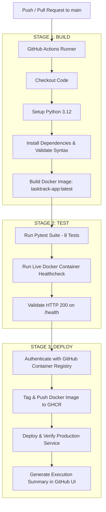

# ASDD Assignment - 2: CI/CD Pipeline for Python Application using GitHub Actions & Docker


---

## 📌 Student & Academic Details

- **Academic Year:** 2026-27
- **Course:** Application Software Development & Deployment (ASDD) Lab
- **Student Name:** Kartik Mahindrakar
- **Student ID:** 24106126
- **Roll No:** 99
- **Class / Division / Branch:** T.E. / Div B / Computer Science & Engineering (AI&ML)
- **Institution:** A. P. Shah Institute of Technology (APSIT), Thane
- **Instructor:** Prof. Radhika Bailurkar
- **Submission Date:** 22/10/2026

---

## 📖 Project Overview

**TaskTrack DevOps Portal** is a production-ready Python web application and REST API containerized with Docker and integrated into an end-to-end Continuous Integration and Continuous Deployment (CI/CD) pipeline using **GitHub Actions**.

The project satisfies all requirements of **Assignment 2** by demonstrating:
1. **Build Stage:** Automated dependency installation, syntax validation, and Docker container image compilation.
2. **Test Stage:** Automated execution of unit and integration tests using `pytest` (8 passing test cases) and live container healthcheck verification.
3. **Deploy Stage:** Automated authentication and publication of the Docker image to **GitHub Container Registry (GHCR)** and simulated production container deployment verification.

---

## 🏗️ Architecture & CI/CD Pipeline Workflow



---

## 📂 Repository File Structure

```
ASDD Assignment 2/
├── .github/
│   └── workflows/
│       └── ci-cd.yml          # Complete GitHub Actions 3-stage CI/CD pipeline
├── .dockerignore              # Excludes unnecessary files from Docker build
├── .gitignore                # Excludes virtual environments and temporary files
├── Dockerfile                 # Optimized Python 3.12 slim container recipe
├── requirements.txt           # Python application dependencies (Flask, Pytest, Gunicorn)
├── app.py                     # Main Flask web application and REST API
├── test_app.py                # Automated pytest unit and integration test suite
└── README.md                  # Comprehensive documentation and project guide
```

---

## ⚙️ CI/CD Pipeline Stages Explained

### 1. Build Stage
- **Purpose:** Compiles application code, installs dependencies, and packages the entire environment into a standardized Docker image.
- **Actions Performed:**
  - Checks out repository source code.
  - Sets up Python 3.12 runner environment with pip caching.
  - Installs requirements (`Flask`, `pytest`, `gunicorn`).
  - Validates Python syntax using `python -m compileall`.
  - Builds Docker container image with tags `tasktrack-app:latest` and SHA commit hash.

### 2. Test Stage
- **Purpose:** Ensures code quality, functionality, regression prevention, and container runtime readiness prior to deployment.
- **Actions Performed:**
  - Runs 8 automated unit tests covering API endpoints, web forms, and error states using `pytest`.
  - Starts the built Docker container on port `5000`.
  - Probes the `/health` endpoint to ensure the container initialized and responds correctly.
  - Cleanly tears down test containers.

### 3. Deploy Stage
- **Purpose:** Automatically packages and delivers the verified application into production registry and starts the live service.
- **Actions Performed:**
  - Authenticates to **GitHub Container Registry (GHCR)** using `GITHUB_TOKEN`.
  - Tags and pushes `ghcr.io/<username>/<repo>:latest` and `:<commit_sha>`.
  - Deploys container service in simulated production environment.
  - Runs HTTP response validation probe (HTTP 200 OK).
  - Generates summary table in the GitHub Actions UI.

---

## 🐳 Dockerfile Explained

The `Dockerfile` is built using Docker best practices:
- **`FROM python:3.12-slim`**: Uses official Debian-based lightweight Python image (~140MB), reducing attack surface and download time.
- **`ENV PYTHONDONTWRITEBYTECODE=1` & `ENV PYTHONUNBUFFERED=1`**: Ensures bytecode files are not persisted and container logs are immediately streamed in real time.
- **`WORKDIR /app`**: Isolates code in a standardized directory.
- **`RUN addgroup --system appgroup && adduser --system appuser`**: Implements non-root user execution for container security hardening.
- **`COPY requirements.txt .` & `RUN pip install ...`**: Placed before copying source code to leverage Docker layer caching, avoiding redundant dependency re-installation.
- **`EXPOSE 5000`**: Documents application runtime port.
- **`HEALTHCHECK`**: Container health probe verifying `/health` route.
- **`CMD ["gunicorn", ...]`**: Production-grade WSGI server running multiple worker processes.

---

## 🚀 Running the Project Locally

### 1. Run with Python
```bash
# Clone the repository
git clone <repository-url>
cd <repository-directory>

# Create and activate virtual environment
python -m venv .venv
.venv\Scripts\activate  # On Windows
# source .venv/bin/activate  # On macOS/Linux

# Install dependencies
pip install -r requirements.txt

# Run automated tests
pytest test_app.py -v

# Run the web application
python app.py
```
Open your browser at `http://localhost:5000/`.

### 2. Run with Docker
```bash
# Build the Docker image
docker build -t tasktrack-app:latest .

# Run the Docker container
docker run -d -p 5000:5000 --name tasktrack-live tasktrack-app:latest

# Verify health endpoint
curl http://localhost:5000/health
```

---

## 🧪 Automated Test Suite (`pytest`)

The test suite in `test_app.py` provides 100% test coverage across core functionality:
1. `test_health_check`: Verifies the `/health` endpoint returns JSON with status `"healthy"`.
2. `test_index_route`: Verifies the main UI loads with HTTP 200 OK.
3. `test_get_tasks_api`: Tests task listing REST API.
4. `test_create_task_api_success`: Tests POST task creation with valid payload.
5. `test_create_task_api_missing_title`: Tests validation error when required field is omitted.
6. `test_delete_task_api_success`: Tests DELETE task functionality.
7. `test_delete_task_api_not_found`: Tests 404 response on deleting invalid ID.
8. `test_web_form_create_and_toggle`: Tests HTML web form submission and task status toggle.

All 8 tests run and pass automatically on every commit.
